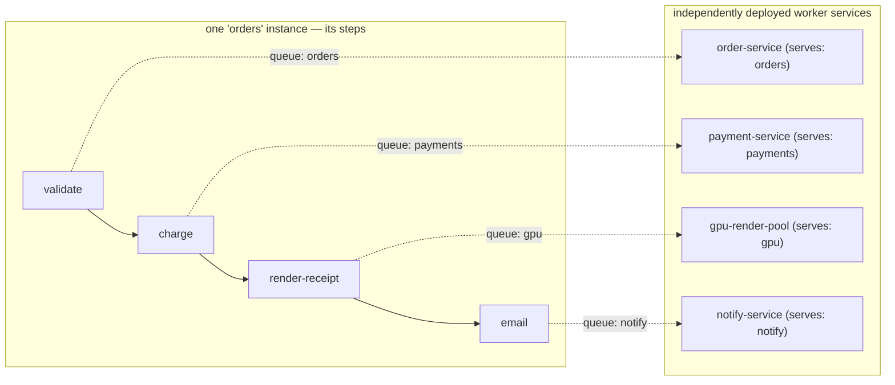
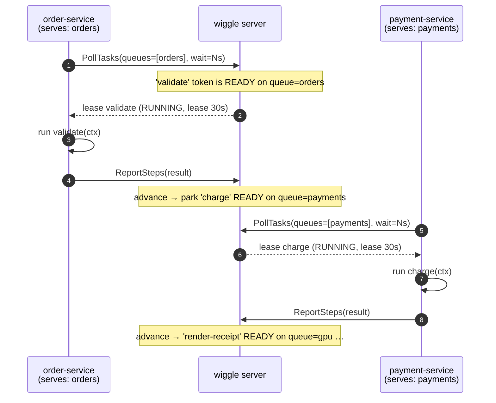
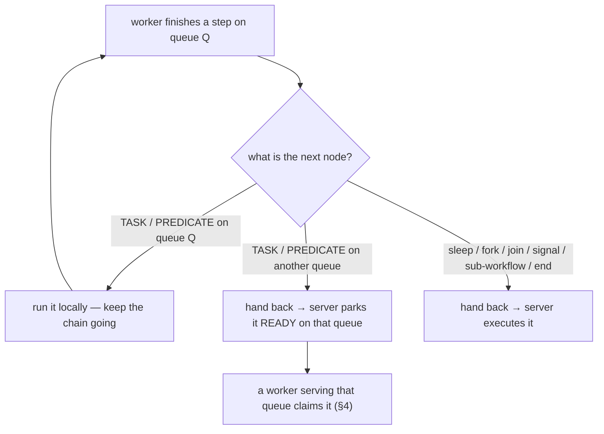

# Queues — distributing one workflow across many microservices

How wiggle spreads a single workflow's steps across independently deployed services. Each step carries a
**queue**; each service **serves** one or more queues and pulls work for them. The server routes every
step to its queue, so different services execute different steps of the *same* instance — no message
broker, no service-to-service calls, no inbound connectivity to the workers.

> One-line model: **a step names a queue; a service serves a queue; the server matches them.** Work is
> *pulled* by workers, never pushed — so services scale independently and need no open ports.

---

## 1. The picture

A step's queue decides which service runs it. With no queues declared, a workflow uses **one** queue
(its own name) and every worker registered for it shares the load. Declaring per-step queues splits the
flow across specialized services:



One instance; four services; the server hands each step to the service that serves its queue. `charge`
runs on the PCI-scoped payment service, `render-receipt` on the GPU pool, `email` on the egress-allowed
notify service — each deployed, scaled, and secured on its own.

---

## 2. Pin a step to a queue (authoring)

The queue is a trailing argument on a step (and on effects/gates). Or set a `defaultQueue` for every
step after it. Unset ⇒ the queue is the **workflow name**.

<!-- snippet: queues/topology -->
```java
FlowSpec orders = FlowSpec.define("orders", 1, Order.class, OrderSteps.class, (f, s) -> f
        .thenApply(s::validate)                    // queue "orders" (the default)
        .thenApply(s::charge, "payments")          // queue "payments"
        .thenApply(s::renderReceipt, "gpu")        // queue "gpu"
        .thenApply(s::email, "notify"));           // queue "notify"
```

The queue is compiled onto each node (`Node.queue`) and collected into the definition's queue set. It is
a plain string label — there is no broker to declare or provision; the label *is* the routing key.

**Only worker steps are queued.** Tasks and predicates (gates) run on workers, so they carry a queue.
`sleep`, `fork`/`forEach`, `join`, `signal`, `sub-workflow`, and `end` are executed **server-side** and
are never routed to a queue — see §5.

---

## 3. Serve a queue (a worker = a microservice)

A worker binds handlers for the workflows it can run and, by default, serves **every** queue those
workflows mention. (It does not publish the topology — the author does; the worker fetches the graph
by name to validate its handlers against.) `withQueues(...)` restricts what it serves — that's how
you build a specialized service:

<!-- snippet: queues/specialised-worker -->
```java
// gpu-render-pool: a service that ONLY runs the "gpu" steps
Worker gpu = new Worker(client, "gpu-1",
                WorkerOptions.defaults().withQueues("gpu"))   // specialization
        .registerHandler(new GpuHandlers())   // fetches the graph by name; only claims gpu-queue steps
        .start();
```

<!-- snippet: queues/general-worker -->
```java
// order-service: default = serve every queue its bound steps live on
Worker general = new Worker(client, "order-1").registerHandler(new OrderHandlers()).start();
```

A worker doesn't subscribe through a broker. It **long-polls** the server for its served queues; the
server leases it only tokens whose queue it serves. Nothing is ever pushed — a worker needs no inbound
connectivity and can scale to any number of replicas.

The flip side of specialization is that a queue **no** worker serves is a queue whose tokens sit
`READY` forever — not failed, not retried, just never claimed, while the instance still reads
`RUNNING`. That is what the console's **Backlog** tab is for: it lists the dispatchable backlog by
`(workflow, version, queue)` and flags any slice no live poller covers. Worth a look after changing
a `withQueues(...)` set or retiring a service.

### Narrowing a queue with criteria

`withQueues(...)` decides *which queues* a worker serves. `withCriteria(...)` also decides *which
tasks on them* it claims, with a predicate built like a JPA Criteria query:

<!-- snippet: queues/criteria-worker -->
```java
// payments-eu: serves the "payments" queue, but only charges of orders keyed "eu-..."
QueueCriteria euCharges = QueueCriteria.from("payments")
        .where(cb -> cb.and(
                cb.equal(Task_.STEP, "charge"),
                cb.like(Task_.CORRELATION_ID, "eu-%"),
                cb.lessThan(Task_.ATTEMPT, 4)));
Worker eu = new Worker(client, "payments-eu-1",
                WorkerOptions.defaults().withCriteria(euCharges))
        .registerHandler(new OrderHandlers())
        .start();
```

A predicate can test the task's workflow, version, queue, step name, node id, kind, attempt (1 on
the first run), the instance's correlation id, and when the instance was created. Comparisons
combine with `and`, `or` and `not`. A comparison on a value the task doesn't have (an instance with
no correlation id, say) is false, and `not` of it is true. Text orders by code point and `like` is
case-sensitive, the same on every store.

The server applies the predicate in the claim itself, so a worker never receives a task it would
have to refuse. A local-execution chain hands back at the first step the criteria don't match. A
worker sets `withQueues` or `withCriteria`, not both. Tasks that no worker's criteria match stay
`READY`, exactly like tasks on a queue nobody serves, so check the Backlog tab after changing them.

#### Routing on business data

The fields above are the task's own. To route on the data an instance carries (a region, a tenant,
an amount), the flow declares **attributes**: a name, a type, and a dotted path into the context.

<!-- snippet: queues/attributes -->
```java
FlowSpec orders = FlowSpec.define("regional-orders", 1, RegionalOrder.class, RegionalSteps.class, (f, s) -> f
        .attribute("region", AttrType.STRING, "customer.region")   // read from each step's context
        .attribute("total", AttrType.DECIMAL, "total")
        .thenApply(s::validate)
        .thenApply(s::charge, "payments"));

// payments-eu-large: EU charges of 1000 or more
QueueCriteria euLarge = QueueCriteria.from("payments")
        .where(cb -> cb.and(
                cb.equal(Task_.attr("region", String.class), "eu"),
                cb.greaterThanOrEqualTo(Task_.attr("total", java.math.BigDecimal.class),
                        new java.math.BigDecimal("1000"))));
Worker large = new Worker(client, "payments-eu-large-1",
                WorkerOptions.defaults().withCriteria(euLarge))
        .registerHandler(new RegionalHandlers())
        .start();
```

Each time a step becomes ready, the server reads the attributes from the context that step will
receive and stores them beside the task. The values therefore follow the data: a step that moves an
order to another region hands the next step to the workers for that region. A path that doesn't
resolve, or a value that doesn't fit the declared type (an object, a number under `STRING`, a
fraction under `LONG`), leaves the attribute absent rather than failing. Types are exact: `"1000"`
the string never equals `1000` the number, while `LONG` and `DECIMAL` compare by value. A flow
declares at most 16 attributes, and only the declared paths are copied out of the context.

What a claim costs depends on how often the predicate matches. Measured on PostgreSQL with a
million ready tasks on one queue:

- **Matches are common** (1% or more, spread through the queue): about 1 ms with task fields and
  3 ms with attributes, at any depth. The claim walks the queue oldest-first and stops after a few
  thousand rows at most. Wiggle's PostgreSQL connections price random reads at
  `random_page_cost` 1.1 for this (`WIGGLE_PG_RANDOM_PAGE_COST`): at the server default of 4, a
  common correlation-id prefix the planner judges rare makes it read and sort every ready task
  instead, about 20 ms at 100,000.
- **An attribute matches rarely or never**: under 1 ms when nothing matches. When only the newest
  tasks match, the cost grows with the number of matching tasks rather than the queue depth (22 ms
  for 10,000). The attribute value indexes let the claim start from the matching rows.
- **A task field matches rarely or never** (a correlation id no ready task has, say): the claim
  reads the whole queue, about 250 ms per poll at a million tasks. An idle worker re-polls about
  every 100 ms. Routing on a value that is often absent from a deep queue belongs in an attribute,
  not a task field.

The full contract is in [the spec](spec/25-queue-criteria.md).

---

## 4. How the server routes a step to its queue

The routing is two moves the server makes with the same `queue` label:

1. **Stamp.** When an instance advances to a worker step, the server parks that step's token `READY` and
   stamps the token's `queue` from the node (`parkAtWorkerStep`: `token.queue = node.queue()`).
2. **Filter.** A poll claims `READY` tasks whose `queue` is in the worker's served set
   (`claimTasks` filters `queues.contains(token.queue)`), flips them to `RUNNING`, and stamps a
   **lease** owned by that worker. Tasks of the oldest instances go first, then the longest-ready, so
   under a backlog the server finishes the instances it started before advancing newer ones.

So the token's queue (from the DSL) is exactly what the claim filters on. A worker receives a step **iff**
that step's queue ∈ the worker's served queues.



The lease gives **exactly-once dispatch** (only the lease owner may complete) and **at-least-once
execution** (if a worker dies, its lease expires and the step is redelivered to another worker on the
same queue — a long step keeps its lease alive with `HeartbeatTask`). The poll is a real long-poll: the
server holds the request open until work appears or the wait elapses, so idle queues cost no busy-polling.

---

## 5. Local execution and the queue boundary

To cut per-step round-trips, a worker can run a **chain** of consecutive steps in-process
(`LOCAL_SYNC` / `LOCAL_ASYNC` execution modes) instead of completing one step at a time (`SERVER` mode).
But it can only keep running steps **on a queue it serves**. At any other boundary it *hands back* to the
server, which routes the next step to whoever serves its queue:



The decision is one pure function (`GraphTraversal.classify`): a same-queue task/predicate is the only
thing a worker keeps; everything else — a different queue, or a server-executed node — is a handback. So
even inside a local chain, a step on another queue crosses to another service. Example
(`LocalBoundaryTest`): steps `a`, `b`, `d` on `general` and `c` on `special` — the `general` worker runs
`a`→`b`, hands back at `c`, the `special` worker runs `c`, and control returns to `general` for `d`.

> The server independently forces a handback whenever the next node isn't a worker step (fork/join/…),
> since no worker can run those locally regardless of queue. Queue *filtering* on the next poll is always
> enforced server-side, so a worker can never run a step off its queues even if it tried.

---

## 6. Why this is a microservice-distribution mechanism

- **A queue is a service boundary.** Put a step on a queue and only the pool serving that queue runs it:
  the GPU steps on GPU nodes, the PII steps in the compliance boundary, the slow third-party call in a
  pool sized for that latency — each deployed and scaled on its own.
- **One instance, many services.** The server keeps the durable state machine; services are stateless
  workers that pull the steps they own. Add replicas of any service to scale that stage independently.
- **No broker, no service mesh for this.** There's no queue infrastructure to run and no worker-to-worker
  calls — services only talk to the wiggle server, and only by pulling. Workers need no inbound ports.
- **Polyglot services on the same queues.** Workers in [Python](https://github.com/hadielmougy/wiggle-python)
  and [Go](https://github.com/hadielmougy/wiggle-go) speak the same control plane; dispatch is by queue +
  activity name, not by language, so a Go service and a Java service can run different steps of one flow.

---

## 7. Operating queues

- **Specialization pattern:** a step's queue argument (`step("render", fn, "gpu")`) paired with a
  dedicated pool (`WorkerOptions.defaults().withQueues("gpu")`). See README → *Running workers*.
- **Backpressure & fairness:** a worker only polls for `concurrency − in-flight` slots, and the server
  leases oldest-`READY`-first, so a queue's work is shared across its replicas without a step running
  twice.
- **Queue lag monitoring:** the server can warn when a queue accumulates a backlog with no throughput —
  see README → *Queue lag monitoring*.

---

## 8. Code map

| Concept | Where |
|---|---|
| default queue = workflow name; per-step `queue` | `client/**/dsl/Pipeline.java`, `client/**/dsl/WorkflowStream.java` |
| queue compiled onto a node; worker-step set | `core/**/Node.java`, `client/**/dsl/WorkflowDefinition.java` |
| a worker's served queues + specialization | `client/**/worker/Worker.java`, `client/**/worker/WorkerOptions.java` |
| long-poll for served queues | `client/**/worker/Worker.java` (`pollLoop`), `server/**/grpc/GrpcApi.java` |
| stamp token queue / claim-filter by queue | `server/**/engine/WorkflowEngine.java` (`parkAtWorkerStep`), `server/**/store/*Storage.java` (`claimTasks`) |
| local-vs-handback decision | `core/**/GraphTraversal.java` (`classify`), `server/**/engine/WorkflowEngine.java` (`applyRun`) |
| RPCs (`PollTasks`, `ReportSteps`, `FailTask`, …) | `proto/src/main/proto/wiggle.proto` |

---

**Submitters need even less than workers.** Everything above is about *serving* steps; a service
that only starts instances needs no FlowSpec and no shared jar at all — `client.start("orders",
context)` by name is the whole integration, with the context schema as the contract. See
[onboarding §5.2](onboarding.md#52-running-instances).
